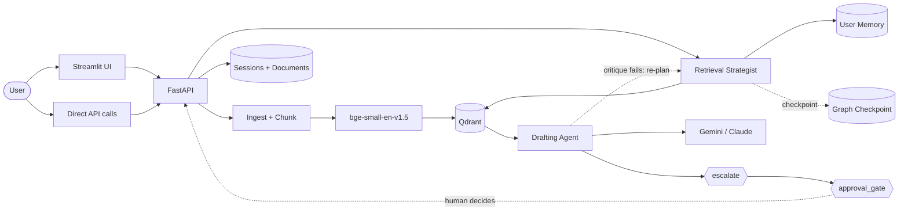

# Technical Design Document

Standalone system design for the Proposal Response Assistant, as a spec in
its own right rather than code-adjacent notes. For the already-existing,
more implementation-level documents this draws on, see
[ARCHITECTURE.md](ARCHITECTURE.md) (component responsibilities and design
rationale), [EVALUATION.md](EVALUATION.md) (metrics methodology and
results), [FAILURE_MODES.md](FAILURE_MODES.md) (failure inventory), and
[DEPLOYMENT.md](DEPLOYMENT.md) (how the pieces are actually hosted).

Requirements this design satisfies: [PRD.md](PRD.md).

## System context

One FastAPI service, one LangGraph-orchestrated chat path, one Streamlit
demo UI as a thin client over the API. No separate services to deploy
beyond the API, a vector store, and a relational store — see
[DEPLOYMENT.md](DEPLOYMENT.md) for where each runs.

## Tech stack

| Layer | Choice | Why |
|---|---|---|
| Backend | FastAPI, Pydantic | request/response typing and validation at the API boundary |
| Agent orchestration | LangGraph | explicit state machine with native checkpointing and `interrupt()`, rather than a hand-rolled retry loop |
| RAG primitives | LangChain (text splitting), custom retrieval/generation chain | reused by the graph, not duplicated |
| Vector store | Qdrant | embedded locally (zero-setup dev), real service via Docker in prod; separate collections for document chunks and cross-session memory |
| Embeddings | `BAAI/bge-small-en-v1.5` via `fastembed`/ONNX Runtime | local, no per-call API cost, light enough for Render's free tier, no torch dependency |
| LLMs | Google Gemini / Anthropic Claude | dual-provider abstraction shared with `ai-resume-matcher` |
| Session storage | SQLModel: SQLite (dev) / PostgreSQL (prod) | same local-first-dev / production-shaped-deploy split throughout |
| Graph checkpointing | `langgraph-checkpoint-postgres` (`PostgresSaver`) prod, `MemorySaver` dev | durable resume is a hard prerequisite for `interrupt()`, not optional |
| Tracing | OpenTelemetry | one span per node, console exporter dev / OTLP prod |
| Testing | pytest, 87 tests, fully mocked | no network/model load required in CI |
| Containers / CI | Docker, docker-compose, GitHub Actions (lint → test → docker build → eval-gate → publish-eval-metrics) | |

## Component design

| Component | File(s) | Responsibility |
|---|---|---|
| Ingestion | `app/services/ingestion.py` | Load PDF (page-tracked)/Markdown/txt, chunk with overlap |
| Data boundary | `app/services/data_boundary.py` | Scan for UK sort codes/account numbers/NI numbers, reject by default (`DATA_BOUNDARY_MODE`) |
| Embeddings | `app/services/embeddings.py` | Local embedding, no external API call |
| Vector store | `app/services/vector_store.py` | Qdrant dense search + BM25 keyword search, fused via reciprocal rank fusion |
| Agent graph | `app/services/rag_graph.py`, `app/services/agent_state.py` | Two agent roles (Strategist, Drafter) sharing only `RagAgentState`; see graph design below |
| Checkpointing | `app/services/checkpointer.py` | Per-session (`thread_id`) durable graph state |
| HITL approval | `approval_gate_node`, `POST /chat/{session_id}/approve` | `interrupt()`-based pause on commercially-sensitive answers |
| Cross-session memory | `app/services/memory_store.py` | Separate Qdrant collection keyed by `user_id`, distinct from graph checkpointing |
| Tracing | `app/core/tracing.py` | `_traced` decorator per node, one parent span per request |
| Cost estimation | `app/core/cost.py` | Single shared `estimate_cost_usd()` |
| Config/version | `app/core/version.py` | `CODE_VERSION` on every response |
| LLM client | `app/services/llm_client.py` | Dual-provider abstraction, vendor-native timeout/retry |
| Evaluation | `app/services/evaluation.py` | RAGAS-methodology metrics, scores the real graph output |

## Agent graph design

Flow (`app/services/rag_graph.py`): `recall_memory` → `strategize` → `retrieve`
→ `draft` → `critique` → (retry to `strategize`, capped at 2) → `escalate`
→ `approval_gate` → `remember`.

Key design decisions:

- **Two agent roles, not one function doing both jobs.** The Strategist
  decides sub-queries/top_k and never sees retrieved text; the Drafter
  writes from evidence and never decides search strategy. They communicate
  only through `RagAgentState` fields.
- **Retries re-plan, not reword.** A failed critique routes back to
  `strategize`, so a retry can mean a broader query or multi-query
  decomposition, not just different phrasing.
- **Escalation is explicit, not silent degradation.** Exhausted retries set
  `escalated=True` and prepend a review banner, rather than returning a weak
  answer indistinguishable from a good one. Genuine refusals are exempted
  from the citation check via `is_refusal()`.
- **`interrupt()` is a real pause, backed by the checkpointer.** `approval_gate_node`
  halts via LangGraph's `interrupt()`/`GraphInterrupt`; nothing downstream
  runs until `POST /chat/{session_id}/approve` resumes via `Command(resume=...)`.
  This only works because checkpointing is enabled — not a separate feature.
- **Graph state avoids framework-opaque types.** Citations are stored as
  plain dicts in graph state (msgpack-serialized to Postgres by the
  checkpointer) and validated into `Citation` Pydantic objects only at the
  API boundary.
- **Routing graph, not a multi-specialist supervisor pattern — deliberately.**
  Four genuine conditional routing decisions exist (no-context short-circuit,
  retry-vs-escalate, 1-vs-many sub-query decomposition, approval
  pause-or-pass-through); none route between different specialist agents,
  because the corpus is single-domain. Manufacturing fake specialist
  boundaries to claim a supervisor pattern was deliberately rejected.

## Data model

| Store | Engine | Contents |
|---|---|---|
| Document registry | SQLModel (SQLite dev / Postgres prod) | ingested document metadata |
| Sessions | SQLModel (SQLite dev / Postgres prod) | `ChatSession`/`ChatMessage` |
| Document chunks | Qdrant | dense + BM25-indexed chunk vectors, `document_id`/`filename`/`page`/`chunk_index`/`score` |
| Cross-session memory | Qdrant (separate collection) | embedded Q&A pairs keyed by `user_id` |
| Graph checkpoints | `langgraph-checkpoint-postgres` (Postgres prod) / in-memory (dev) | per-`thread_id` graph state, msgpack-serialized |

Two distinct memory mechanisms are deliberately not merged: the graph
checkpoint is short-term/thread-scoped (resuming one in-flight run); the
cross-session store is long-term (semantic recall across different,
completed sessions). Nothing is promoted automatically between them.

## API design

| Method | Path | Notes |
|---|---|---|
| `GET` | `/health` | Liveness, includes `code_version` |
| `POST` | `/documents` | Upload + chunk + embed; `422` on data-boundary violation |
| `GET` | `/documents` | List ingested documents |
| `DELETE` | `/documents/{id}` | Remove a document and its vectors |
| `POST` | `/chat` | `user_id` (optional, cross-session memory), `require_approval` (optional, HITL gate); returns answer + citations + latency/token/cost + faithfulness + retry count + `escalated` + `code_version` + Strategist reasoning. `pending_approval: true` and `answer: null` if paused |
| `POST` | `/chat/{session_id}/approve` | `{"approved": bool, "reason": str?}`; `409` if nothing is paused on that session |
| `GET` | `/chat/{session_id}/history` | Conversation history |
| `POST` | `/evaluate` | Score a single question/answer against retrieved context |

All endpoints gated by a shared `X-API-Key` header when `API_KEY` is set
(`app/core/auth.py`); no-op in local dev when unset.

## Reliability and failure handling

Full inventory in [FAILURE_MODES.md](FAILURE_MODES.md), organized by
ingestion / retrieval-and-drafting / quality-gates / human-oversight /
infrastructure-and-recovery. Summary of the escalation philosophy:

- Quality problems (ungrounded/uncited answers) retry, then get a visible
  review banner.
- Commercial-sensitivity problems pause for a named human decision.
- Infrastructure problems (killed process, bad corpus) recover via durable
  state and one-command rollback, not manual reconstruction.
- Nothing fails silently — every row in the inventory has a code and test
  reference, or it isn't claimed as handled.

Known gaps, stated plainly: per-user identity and per-tenant data isolation
are both built (per-key, see `app/core/auth.py` and `owner_id` filtering in
`app/services/vector_store.py`); the CI eval gate is not yet a required
branch-protection check.

## Observability

- **Tracing:** one OpenTelemetry span per graph node, nested under one
  parent span per request, carrying cost/latency/retry attributes. Console
  exporter in dev, `OTEL_EXPORTER_OTLP_ENDPOINT` for a real backend in prod.
- **Cost/latency:** `estimate_cost_usd()` shared across `/chat` responses,
  trace spans, and both eval scripts (previously triplicated).
- **Versioning:** `CODE_VERSION` (from `GIT_COMMIT_SHA` or `git rev-parse HEAD`)
  stamped on every `/chat` response, `/health`, and every trace's
  `service.version`. Since prompts/config live as code, the commit SHA is
  the version — no separate prompt-version number to forget to bump.

## Deployment

Local dev needs zero external services: Qdrant runs embedded, sessions
persist to SQLite. `docker-compose.yml` switches to a real Qdrant service
and Postgres via `QDRANT_URL`/`DATABASE_URL`, same code path, no branching.
Production: FastAPI backend on Render, Streamlit dashboard on Streamlit
Cloud, both behind a per-user API-key gate. Full wiring and the
data-boundary incident history: [DEPLOYMENT.md](DEPLOYMENT.md).

## Testing strategy

- **Unit/integration (95 tests, `pytest -q`):** fully mocked, no
  network/model load, covers the retry/cap/memory loop, multi-hop
  sub-query merging, escalation banners, citation enforcement, HITL
  pause/approve/reject lifecycle, checkpointer sqlite-fallback path,
  tracing span hierarchy including `GraphInterrupt` propagation, LLM
  client timeout/retry config reaching the real client object, and the
  per-user API-key gate (valid/invalid/missing key, identity overriding a
  client-supplied `user_id`).
- **Golden set (`eval/golden_set.json`, 50 items):** structural validation
  in CI requires no API key (50 items, ≥10 traps, every source doc exists,
  every trap explains why it's unanswerable). Live scoring
  (`scripts/run_golden_set.py`) requires a real API key and is the
  authoritative quality measurement (see Success metrics in
  [PRD.md](PRD.md)).
- **CI pipeline (`.github/workflows/ci.yml`):** lint → test → docker-build
  → eval-gate (skips without a configured key) → publish-eval-metrics (main
  only, after eval-gate passes).

## Known limitations

- `eval-gate` can fail the CI job but is not yet a required
  branch-protection check — needs a repo secret and a manual
  branch-protection setting.
- Reranking and parent-document retrieval are not implemented (hybrid
  dense+BM25 retrieval is).
- No Word document or web-page ingestion; no streaming chat responses; demo
  UI is Streamlit, not a production frontend.
